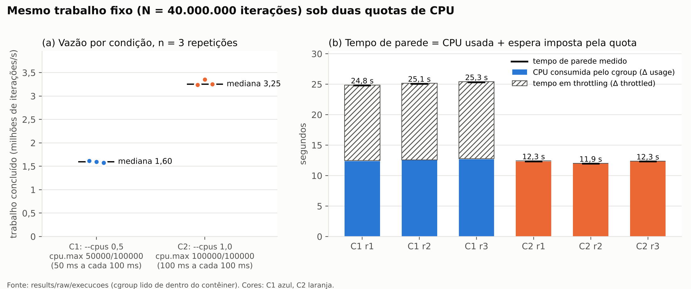
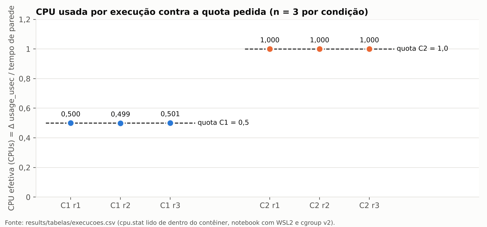
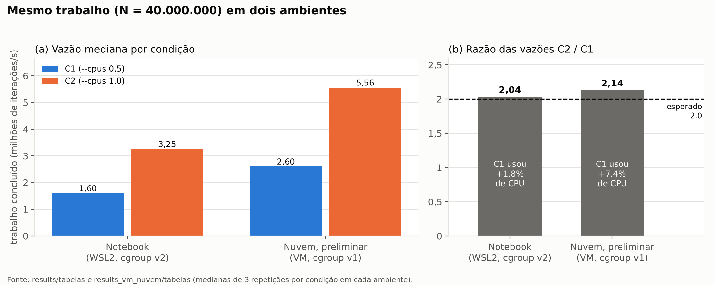
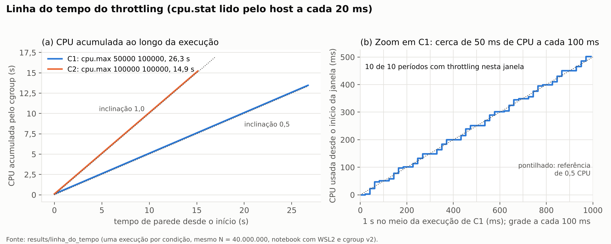

# SO_UFS_2026_2_Melo_Alex_ATV3

Atividade 3 de Sistemas Operacionais (COMP0472, UFS, 2026.2): **virtualização, contêineres, namespaces e cgroups**.
Trabalho individual de **Álex Felipe Santos Melo** (matrícula 202200025395). Professor: Glauco de Figueiredo Carneiro.

**Pergunta norteadora:** como namespaces alteram a visão de processos, mounts e rede, e como cgroups limitam recursos sem transformar um contêiner em uma máquina virtual independente?

* Relatório: [`docs/relatorio_ATV3_SO_Alex_Melo.pdf`](docs/relatorio_ATV3_SO_Alex_Melo.pdf), com a fonte editável em `.docx`
* Slides: [`docs/Slides - ATV3.pdf`](docs/Slides%20-%20ATV3.pdf)
* Vídeo: ver [`VIDEO.md`](VIDEO.md)
* Uso de IA: [`DECLARACAO_IA.md`](DECLARACAO_IA.md). Contribuição: [`CONTRIBUICAO.md`](CONTRIBUICAO.md)
* Commit da entrega: tag `entrega-atv3` neste repositório

## Resultado em uma tabela

Mesmo trabalho fixo (N = 40.000.000 iterações, checksum `098953c3ffd76aa3` conferido fora do contêiner), três repetições por condição, ordem alternada C1 C2, C2 C1, C1 C2, no notebook do discente:

| Condição | `--cpus` | `cpu.max` efetivo | Tempo de parede (mediana) | Trabalho/s (mediana) | Amplitude | Períodos com throttling |
|---|---|---|---|---|---|---|
| C1 | 0,5 | `50000 100000` | 25,07 s | 1,60 M it/s | 2,2% | 100% (12,54 s em throttling) |
| C2 | 1,0 | `100000 100000` | 12,30 s | 3,25 M it/s | 3,4% | 0% na mediana (6 períodos, 3,2 ms, numa repetição) |

Razão das medianas C2/C1: **2,04**. Gerado por `lab/resumo.py` a partir de `results/raw/execucoes/`; nenhum número foi digitado à mão.







**Experimento extra (além do enunciado):** `lab/linha_do_tempo.py` lê o `cpu.stat` pelo host a cada 20 ms, uma vez em C1 e uma em C2. Mostra que a quota não deixa a CPU mais lenta: liga e desliga o processo, cerca de 50 ms de CPU a cada período de 100 ms. Não entra nas medianas.



## Ambiente das medições

| Item | Valor |
|---|---|
| Máquina | notebook com AMD Ryzen 7 7735HS (8 núcleos, 16 threads), 16 GB de RAM |
| Hospedeiro e hipervisor | Windows 11 com Hyper-V |
| Linux do daemon | WSL2, Ubuntu 26.04 LTS, kernel 6.6.114.1-microsoft-standard-WSL2 |
| CPUs, RAM e swap da VM | 4 CPUs lógicas, 7,8 GiB, 2 GiB de swap |
| Docker | Engine 29.1.3 no próprio WSL2 (sem Docker Desktop); Compose não instalado |
| cgroup | **v2**, driver `systemd`, sem limites ancestrais em `system.slice` |
| Segurança do daemon | seccomp padrão e cgroup namespace privado; daemon como root (não rootless) |
| Imagem | `python:3.12-slim` (Debian 13, Python 3.12.16), `python@sha256:5e2bdb1b0d542d5039cffb8181c65930093949194a65c365dfb1b0fe13a4fa5b` |

Detalhes em `results/ambiente/ambiente.txt`.

### Execução preliminar (preservada, fora da análise)

Antes da execução no notebook, o assistente de IA rodou o mesmo laboratório numa VM de nuvem (KVM e Firecracker, Ubuntu 24.04, cgroup v1). Como o Docker Hub estava bloqueado naquela rede, a imagem foi construída com `lab/construir_imagem.sh` a partir do repositório oficial do Ubuntu. Os dados estão em `results_vm_nuvem/` e servem só como conferência: lá a razão C2/C1 foi 2,14.

## Estrutura

```
lab/
  ambiente.sh             Parte A: kernel, distribuição, CPUs, RAM, Docker, cgroup e imagem
  evidencia_ns_mount.sh   Partes B e D: dois contêineres, handles de namespaces e teste read-only
  carga_cpu.py            carga determinística com trabalho fixo, checksum e leitura do cgroup (v1 e v2)
  run_experimentos.sh     Parte C: C1/C2 x 3 repetições, alternadas, preservando tentativas com erro
  resumo.py               tabela consolidada, conferência do checksum e gráfico
  graficos_extras.py      CPU usada x quota, notebook x nuvem e linha do tempo do throttling
  linha_do_tempo.py       experimento complementar: lê o cpu.stat pelo host a cada 20 ms em C1 e C2
  validar.py              confere a entrega sem rodar experimentos
  construir_imagem.sh     imagem alternativa, usada só na execução preliminar
dados_demo/texto.txt      arquivo sintético da Parte D
results/                  execução oficial, no notebook
  ambiente/ambiente.txt
  namespaces/             registro_A.txt, registro_B.txt, registro_host.txt, namespaces.csv
    tentativa1_sem_root/  primeira coleta, sem permissão para ler /proc/<PID>/ns (preservada)
  mount/readonly.txt      leitura ok, escrita negada (EROFS) e controle de permissão (EACCES)
  raw/piloto/             piloto com N = 2.000.000
  raw/execucoes/          6 registros brutos (JSON, stderr e inspect) e indice.csv
  tabelas/                execucoes.csv, resumo_condicoes.csv, resumo.md, checksum de referência
  figuras/                c1_c2.png, cpu_x_quota.png, notebook_x_nuvem.png e linha_do_tempo.png
  linha_do_tempo/         C1.csv, C2.csv e metadados do experimento complementar
results_vm_nuvem/         execução preliminar na nuvem (preservada)
docs/                     relatório, diagrama de camadas, roteiro do vídeo e fontes do relatório
```

## Como reproduzir

Pré-requisitos: Linux com Docker (nativo, VM ou WSL2), `bash`, `python3`, GNU `timeout` e, para o gráfico, `matplotlib` (`pip install -r requirements.txt`). O usuário precisa estar no grupo `docker` (`sudo usermod -aG docker $USER` e abrir uma sessão nova).

```bash
git clone https://github.com/alexfsmelo/SO_UFS_2026_2_Melo_Alex_ATV3.git
cd SO_UFS_2026_2_Melo_Alex_ATV3
mv results results_entregues   # para não misturar com os dados entregues

# 1. Imagem fixada por digest
docker pull python:3.12-slim
export IMAGEM_LAB="$(docker image inspect --format '{{index .RepoDigests 0}}' python:3.12-slim)"
printf '%s\n' "$IMAGEM_LAB"

# 2. Parte A: ambiente
bash lab/ambiente.sh

# 3. Partes B e D (como root, para ler /proc/<PID>/ns dos processos dos contêineres)
sudo env IMAGEM_LAB="$IMAGEM_LAB" bash lab/evidencia_ns_mount.sh

# 4. Parte C: piloto pequeno, depois N congelado nas seis execuções
REPS=1 ITERACOES=2000000 SAIDA=results/raw/piloto bash lab/run_experimentos.sh
export ITERACOES=40000000
bash lab/run_experimentos.sh
python3 lab/resumo.py

# 5. Experimento complementar e gráficos extras
python3 lab/linha_do_tempo.py
python3 lab/graficos_extras.py

# 6. Conferência
python3 lab/validar.py
```

**Docker Desktop ou daemon remoto:** o `PID_host` de `docker inspect` pertence ao Linux do daemon. O script detecta quando esse PID não existe no `/proc` do terminal e registra `host_local_confirmado=nao`, em vez de ler um `/proc` que não corresponde ao daemon.

**cgroup v1:** `carga_cpu.py` também lê as hierarquias v1 e converte os nomes (`cpu.cfs_quota_us` e `cpu.cfs_period_us` equivalem a `cpu.max`).

### Coleta e limpeza

* Cada execução grava JSON, stderr e `inspect` em `results/raw/execucoes/`. Uma nova tentativa da mesma execução recebe sufixo `_t2`, `_t3`; nada é apagado.
* Os scripts encerram somente os contêineres que criaram (nome com o PID do script e label `lab3=atv3`). Para conferir: `docker ps -a --filter label=lab3=atv3`.
* Limpeza completa: `docker ps -aq --filter label=lab3=atv3 | xargs -r docker rm -f`.

## Segurança

* Carga limitada a 60 s dentro do contêiner e a 90 s no host (GNU `timeout`).
* Execuções com `--network none`, usuário 65534, `--cap-drop ALL` e `--security-opt no-new-privileges`.
* Nenhum `--privileged`, nenhuma escrita manual em `/sys`, nenhum fork bomb, falta de memória deliberada ou escalonador de tempo real.
* A Parte D monta apenas `dados_demo/` (arquivo sintético) e um diretório de controle vazio; nunca `/`, a home, o socket do Docker ou pastas sigilosas.
* `ambiente.sh` usa campos formatados de `docker info`, sem hostname, usuário ou credenciais.
